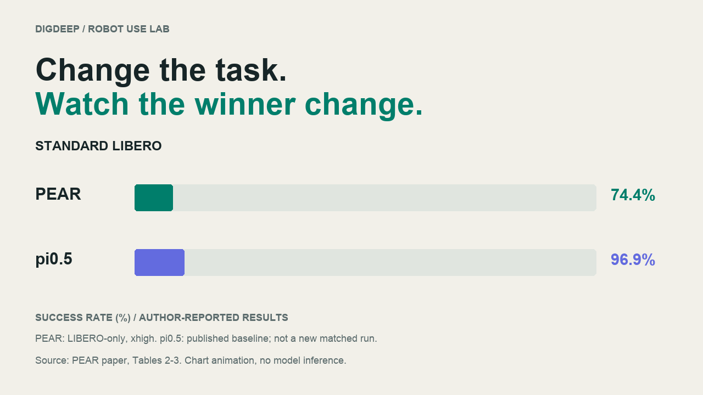

# Robot Use Lab
### Change the instruction. Watch the winner change.

An independent investigation of **PEAR**, general-purpose reasoning models, and robot control by [Ajay Cyril](https://digdeeptech.com).

[Open the interactive lab](https://ajaycyril.github.io/robot-use-lab/) · [Research notes](RESEARCH.md) · [Reproduction guide](REPRODUCE.md) · [Original PEAR project](https://mit-han-lab.github.io/pear-blog/)



**What has run:** the published-data audit, workload-mixture calculation, and numerical checks. **What has not run:** PEAR inference, training, or new robot trials. The browser explorer reads published results; it does not run a model.

## The question
Does a policy still follow language when a familiar scene asks for a different action? PEAR's results make this a useful test, while also showing that the strongest answer depends on what changes.

| Condition | PEAR LIBERO-only, xhigh | π0.5 |
|---|---:|---:|
| Standard LIBERO | 74.4% | 96.9% |
| Changed goal | 57.4% | 0.75% |
| Swapped positions | 57.5% | 20.8% |
| Reworded instruction | 73.3% | 95.8% |
| Restyled objects | 60.2% | 96.0% |

Source: PEAR paper Tables 2–3. The π0.5 results are cited from openpi and LIBERO-Pro, not a fresh matched run by PEAR's authors. These are particular checkpoints and protocols, not all VLAs.

## Run the completed analysis
Python 3.10+, no third-party dependencies:

```bash
python3 analysis.py
python3 -m unittest discover -s tests -v
python3 -m http.server 8000
```

Open http://localhost:8000. Outputs are in `results/analysis.json`.

The analysis checks all 30 published real-robot trials, separates failures, calculates an illustrative task-mixture crossover, and estimates decode-only latency sensitivity. Source data and assumptions are included.

## Prepare a real model experiment
[REPRODUCE.md](REPRODUCE.md) defines an 80-episode LIBERO-Pro smoke experiment with identical suite/task/trial keys across five perturbations. The launcher calls the reviewed upstream evaluator and preserves its protocol. It is prepared, not GPU-validated here. It needs a properly provisioned Linux NVIDIA PEAR environment; the official BF16 evaluation recipe is not a laptop or single-5090 quick start.

## What would weaken the thesis?
- General models lose their advantage under matched latency and compute budgets.
- A broader, similarly trained VLA closes the changed-instruction gap.
- WAMs remain stronger on difficult manipulation and unseen dynamics.
- Gains fail to transfer beyond a small number of tasks and embodiments.

## Attribution
PEAR is by Jiaming Tang, Zhuoyang Zhang, Junxian Guo, Fangzhou Zhao, Yilong Zhao, Zekai Li, Xingyang Li, Yuyang Zhao, Song Bian, Zhijian Liu and Song Han. This repository is an independent analysis, not an official implementation or reproduction.

Original code/visuals: MIT license. Third-party code, papers, weights and videos keep their own terms.

